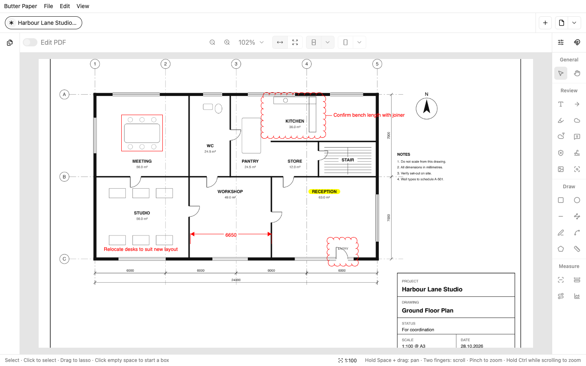
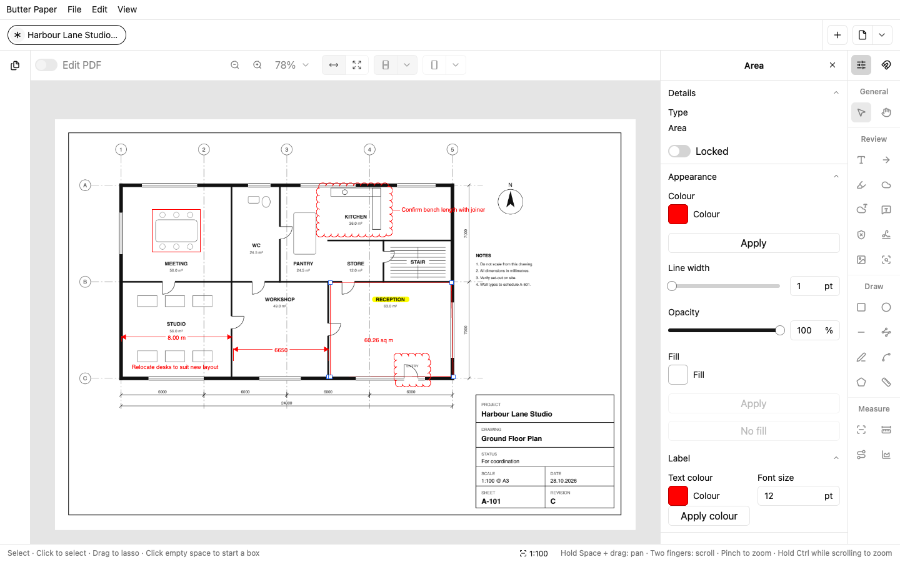
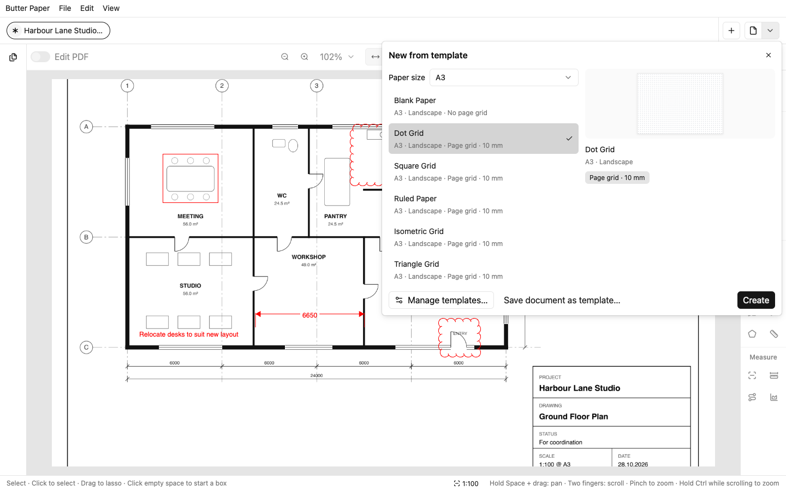

# Butter Paper

Butter Paper is a free, open-source PDF editor and markup app for macOS,
Windows, and Linux, built natively in Rust with GPUI. It also acts as an
alternative to Bluebeam Revu for architecture, engineering, and construction
workflows.

**[Download Butter Paper](https://apotenza92.github.io/butter-paper/)**

- Mark up PDFs with text boxes, callouts, clouds, arrows, highlights, ink,
  shapes, images and redactions.
- Set a drawing's scale, often read straight from its title block, then
  measure lengths, perimeters and areas.
- Edit a PDF's own text a paragraph at a time, keeping its fonts and layout.
- Sign documents by drawing, typing, a picture, your phone or a saved
  signature.
- Start new documents from paper templates in A3 and A4, with dot,
  square, ruled, isometric and triangle grids.
- Work with several documents in tabs and windows, with continuous scrolling
  and fast page rendering.
- Markups are saved as standard PDF annotations, so they open in Bluebeam
  Revu, Adobe Acrobat and other PDF apps.
- No account and no tracking. Your documents stay on your computer.

| Measure a scaled drawing | Start from a paper template |
| --- | --- |
|  |  |

Butter Paper isn't affiliated with or endorsed by Bluebeam or Adobe; their
names are trademarks of their respective owners.
